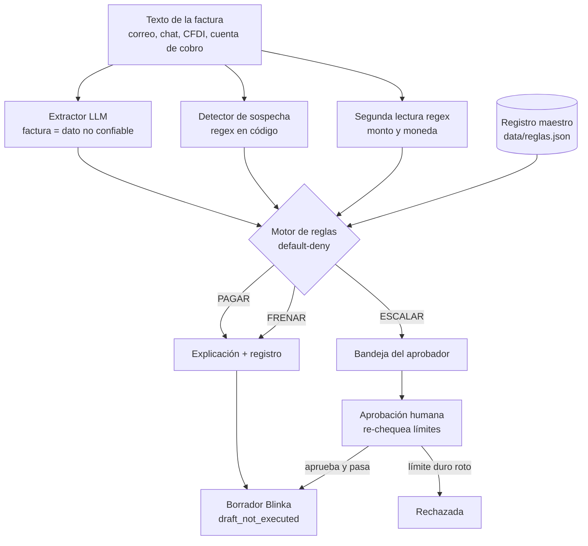
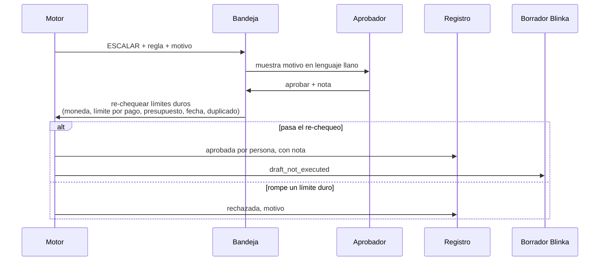

# Arquitectura de Payment Guard

## Flujo de una factura

## Aprobación humana

## Por qué cada decisión de diseño

- **El código decide, el LLM solo lee:** un LLM puede ser engañado; una regla en código es auditable y reproducible.
- **Default-deny:** ante error o duda la salida es ESCALAR, así un fallo nunca se convierte en un pago.
- **Reglas en orden fijo, la primera gana:** el motivo citado es único y predecible; cualquiera entiende el registro sin leer código.
- **FRENAR vs. ESCALAR:** FRENAR es lo inválido sin discusión; ESCALAR es lo que una persona puede aprobar o una señal de fraude. La atención humana se gasta solo donde sirve.
- **Factura = dato no confiable:** se delimita en el prompt, se ignora cualquier instrucción dentro y la detección de injection corre en código, no en el modelo.
- **Se descartan campos extra del LLM:** solo 8 campos de extracción; un `decision` inventado nunca llega al motor.
- **Cuenta y beneficiario del registro maestro:** el fraude típico es el cambio de cuenta; si la factura no puede definir a dónde va el dinero, no puede redirigirlo.
- **Segunda lectura por regex ("doble llave"):** monto y moneda se leen por dos caminos independientes; si discrepan, ESCALAR. El regex se abstiene ante formatos ambiguos en vez de adivinar.
- **Verificador independiente (`allowed_to_pay`):** re-implementa los límites duros sin usar `RULES` ni `decide()`; un bug en el motor no pasa en silencio.
- **Aprobación que re-chequea (idea de imprest):** aprobar no es un cheque en blanco; los límites duros se validan de nuevo en ese momento.
- **Montos con `Decimal` y FX fijo:** sin errores de redondeo ni dependencia de un servicio externo; el cambio fijo se declara como límite.
- **Casetes (`replay`):** demo y tests corren sin red y de forma determinista con las respuestas reales del LLM grabadas; costo $0.
- **Borrador `draft_not_executed`:** el reto pide decidir, registrar y explicar, no mover dinero. El formato Blinka deja listo el paso a una integración real.
- **Django + SQLite:** una sola app con tablero, bandeja, registro y API; sin infraestructura extra.
